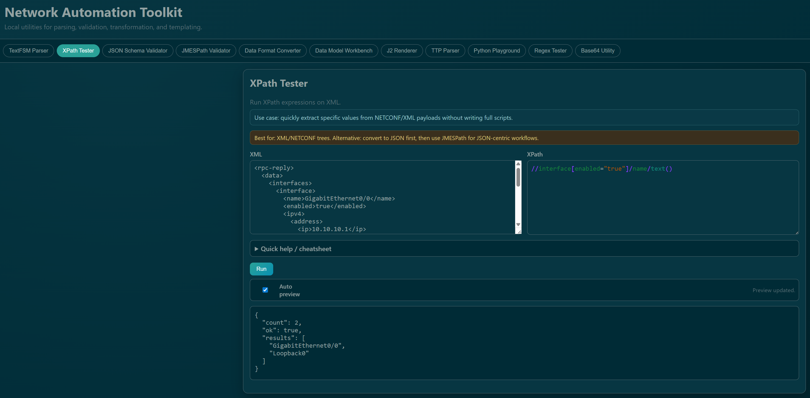
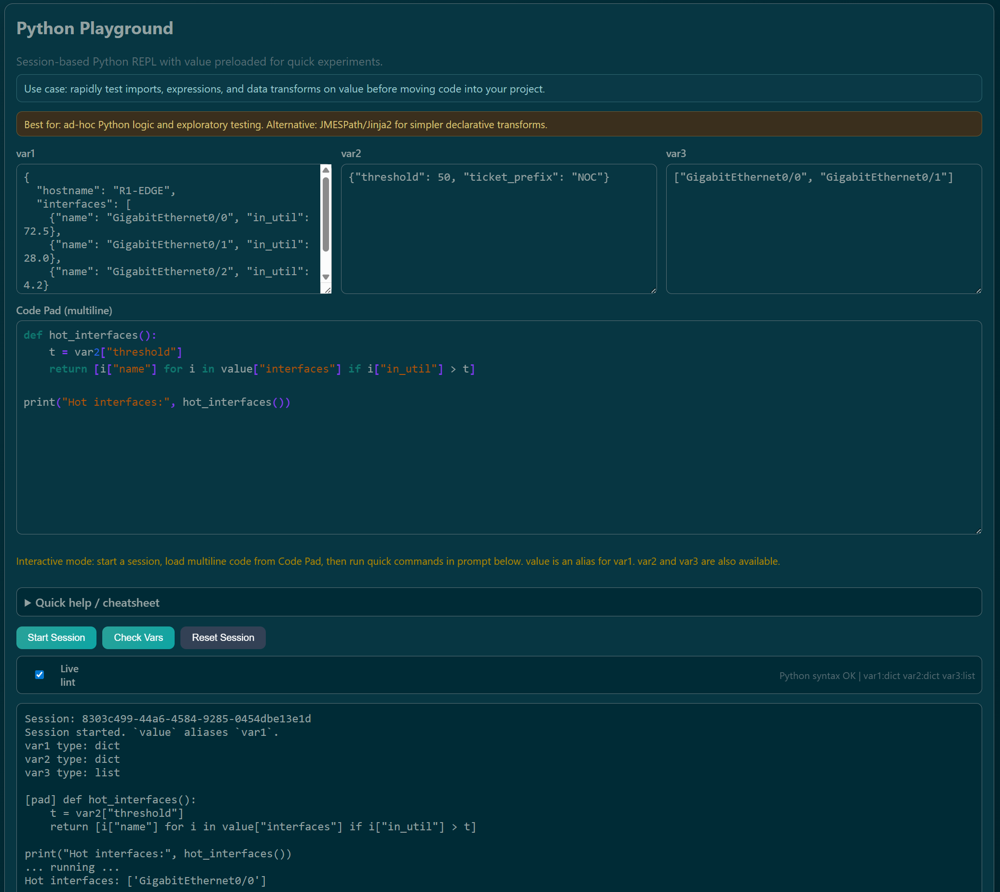
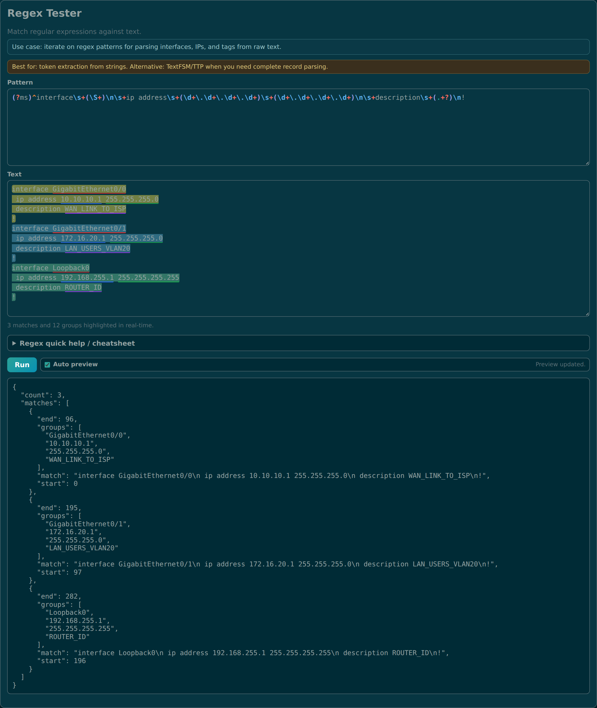
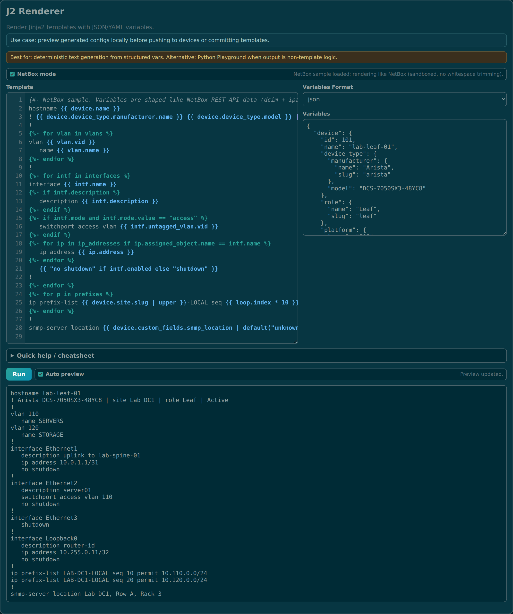
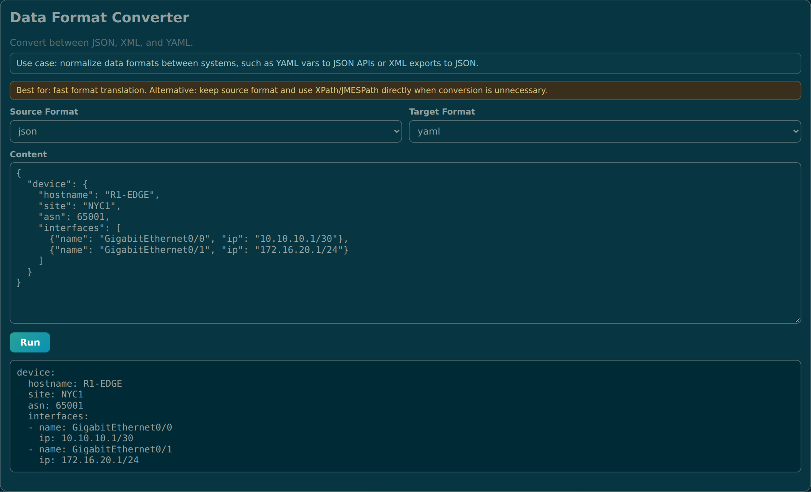
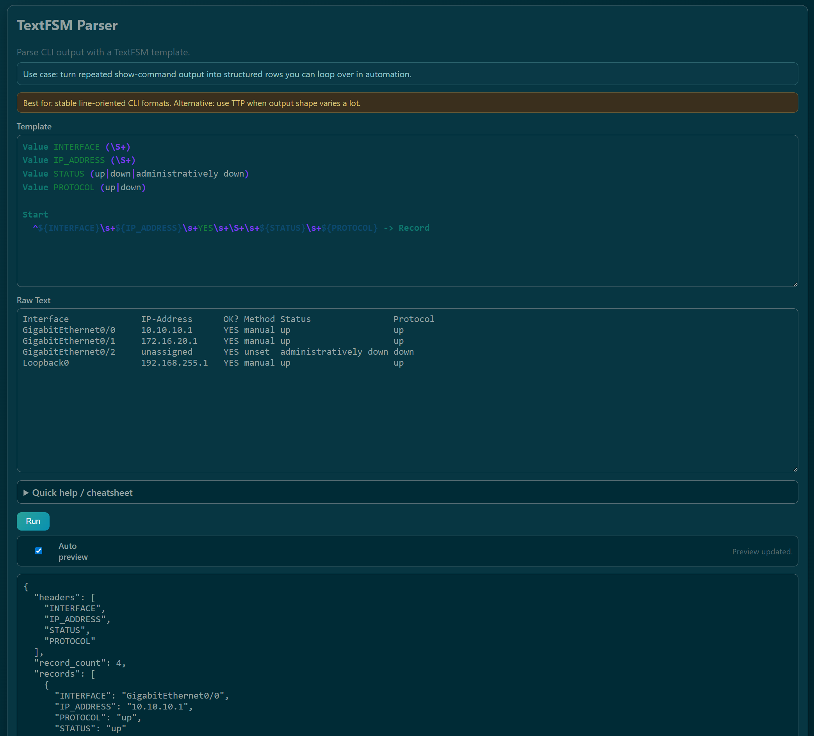

# Network Automation Toolkit

A fast, local-first web toolkit for network engineers to parse, validate, transform, and test data in one place.

Built for day-to-day workflows like CLI parsing, XML/JSON querying, template rendering, and quick Python experimentation.

## Why This Project

When you are troubleshooting automation logic, you often need multiple tools open at once: parser playgrounds, JSON query testers, schema validators, and quick Python scratchpads. This project brings those utilities into a single local app with practical defaults and ready-to-run examples.

## Feature Set

- `J2 Renderer` (Jinja2 template rendering, with an optional NetBox mode)
- `Regex Tester`
- `TextFSM Parser` for structured extraction from CLI output
- `Data Format Converter` (`JSON <-> XML <-> YAML`)
- `JMESPath Validator` for JSON filtering and selection
- `Python Playground` with session state and terminal-style prompt
- `TTP Parser` for semi-structured text parsing
- `XPath Tester` for XML/NETCONF queries
- `JSON Schema Validator` for payload contract checks
- `Data Model Workbench` to infer JSON Schema/Pydantic models and validate payloads
- `Base64 Utility`
- Theme selector with `Sand`, `Solarized`, `Light`, and `Dark` palettes (saved in browser)
- `Ctrl+Enter` runs the current tool, a `Copy` button on every output, and the last-used tab is remembered

## Python Playground Highlights

- Interactive session with persistent state
- Variables available in session:
  - `value` (alias of `var1`)
  - `var1`, `var2`, `var3`
- `Check Vars` detects type and warns when input falls back to plain string
- `Code Pad` for multiline blocks (functions, loops, imports)
- Prompt for quick one-liners
- `Load Code Pad`, `Clear Screen`, and session controls

## Data Model Workbench Highlights

- Generate a first-pass model from real sample payloads (`json_schema` or `pydantic`)
- Validate new payloads against inferred schema before they reach automation code
- Catch data drift early (missing fields, type mismatches, structural changes)
- Speed up model design when integrating new APIs, telemetry, or inventory sources

## J2 Renderer: NetBox Mode

The **NetBox mode** checkbox in the J2 Renderer is off by default; with it off, the renderer works as before.

Ticking it:

- loads a NetBox-style sample: a device with interfaces, IP addresses, VLANs and prefixes, shaped like
  NetBox REST API data (`/api/dcim/...`, `/api/ipam/...`), in JSON or YAML
- renders the way a NetBox 4.7.4 config template does with no `environment_params`: sandboxed,
  autoescape off, no `trim_blocks`/`lstrip_blocks`, missing variables render empty (`Undefined`, not
  `StrictUndefined`), a stub `env` filter, CRLF converted to LF
- shows the template line number in errors

If you have edited the template or variables, you are asked before they are replaced. NetBox models
(`dcim.Device`, `ipam.Prefix`, ...) are not available, so templates must read their data from variables.

## Quick Start

```bash
python3 -m venv .venv
source .venv/bin/activate
pip install -r requirements.txt
./app.py
```

Open: `http://127.0.0.1:5000`

Optional debug mode:

```bash
FLASK_DEBUG=1 ./app.py
```

## Running Tests

```bash
pip install -r requirements-dev.txt
pytest
```

The tests call every API endpoint through Flask's test client (no server needed). They also run on
GitHub Actions for every push and pull request (`.github/workflows/tests.yml`).

## Screenshots

### Overview



### Python Playground



### Regex Tester



### J2 Renderer



### Data Format Converter



### TextFSM Parser



## Project Structure

```text
.
├── app.py                  # Flask app and all API endpoints
├── templates/
│   └── index.html          # Page shell
├── static/
│   ├── app.js              # Tool definitions, editors, live preview, cheatsheets
│   └── style.css           # Layout and themes
├── tests/
│   └── test_app.py         # Endpoint tests (pytest)
├── images/                 # Screenshots used in this README
├── docs/images/            # Earlier screenshots kept for reference
├── requirements.txt
├── requirements-dev.txt    # requirements.txt + pytest
└── pytest.ini
```

## Security Notes

- Python Playground executes Python code locally in your app process.
- Use only trusted input and run on your own machine/network.
- This project is intended for local development and lab workflows.

## Contributing

Issues and PRs are welcome.

Please read [CONTRIBUTING.md](./CONTRIBUTING.md) before opening a PR.

Issue templates are included for:
- Bug reports
- Feature requests

## Acknowledgment

Built with the help of AI to move faster, iterate smarter, and deliver a better developer experience.

Inspired by tools and workflows from Nebula by Packet Coders:
https://nebula.packetcoders.io/textfsm-parser/

## Roadmap Ideas

- Import/export saved sessions and snippets
- More converters (CSV, TOML)
- Diff view for rendered templates
- Plugin-style custom tools

## License

This project is licensed under the MIT License. See [LICENSE](./LICENSE).
